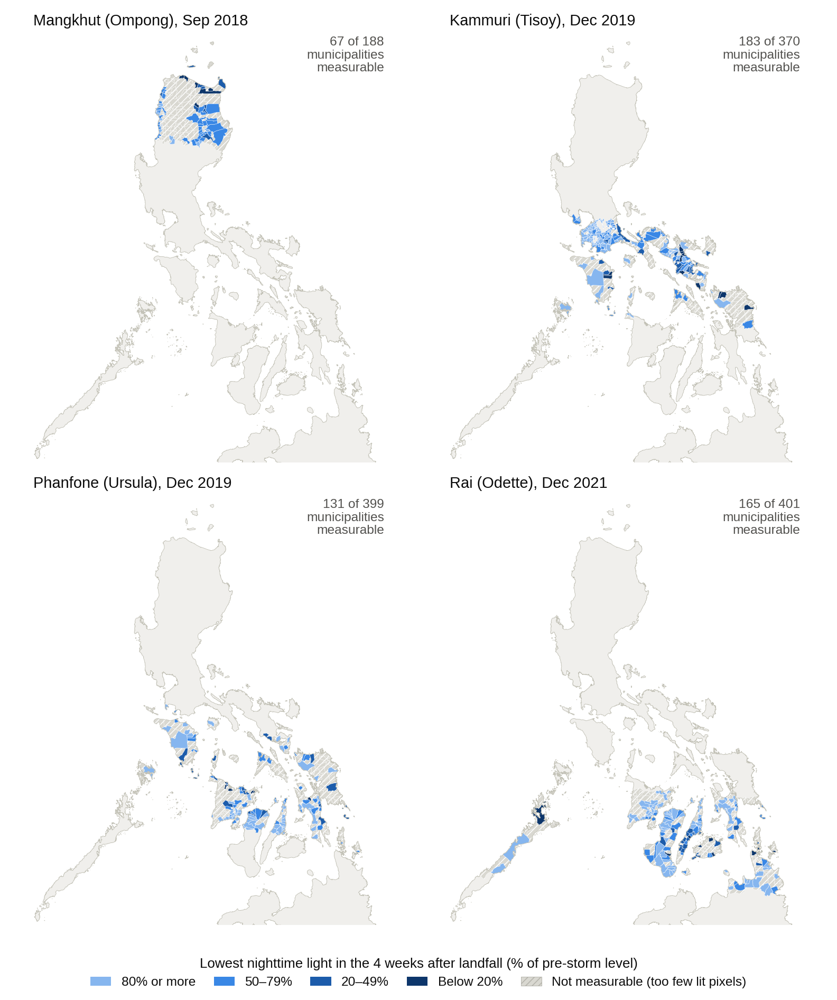
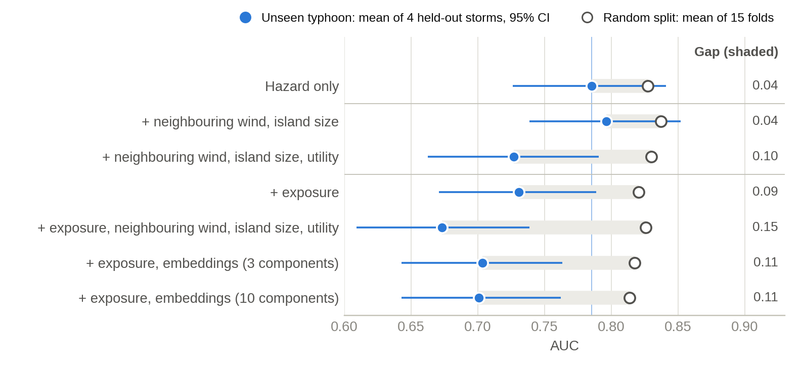
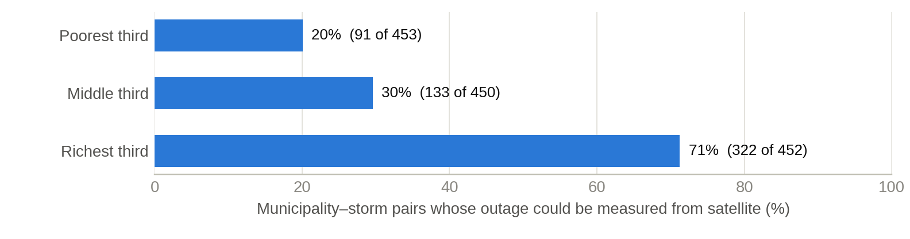

# Who stays dark longest? Predicting power recovery after Philippine typhoons

A pilot study of whether publicly available, pre-event data can predict which municipalities stay without power for more than a week after a typhoon, and whether those predictions transfer to storms the model has never seen. Outage labels come from NASA Black Marble nighttime lights, calibrated against placebo runs, for four typhoons (2018–2021) and 1,358 municipality–storm pairs.

**Author:** Zixiao (Heal) Zhuang, M.A. candidate in Environmental Policy and Management, Middlebury Institute of International Studies
## Key findings

**1. Nighttime lights measure week-long outages, not short ones.** After placebo calibration, 50–90% of measured municipalities within 30 km of a track stayed dark for more than 7 days, against 2.4–3.3% of all municipalities in placebo runs with no storm. The shortest outage detected lasted 3.4 days. In 60% of municipality–storm pairs, too few built-up pixels were lit to measure anything.

**2. The evaluation design decides the answer.** A logistic model using only four hazard features reached a mean AUC of 0.79 (95% CI 0.73–0.84) when each typhoon was held out in turn. Adding exposure variables or AlphaEarth satellite embeddings barely changed random cross-validation scores (AUC 0.81–0.84 for every feature set). The same additions lowered AUC on unseen storms by 0.05–0.08, in at least three of the four held-out storms. Holding out provinces instead of storms gave a milder version of the same pattern.

**3. Errors cluster by electric utility, yet utility attributes hurt transfer.** Utilities explained 30% of the hazard-only model's residual variance in Kammuri and 43% in Rai (permutation p = 0.002), against about 10% and 18% expected by chance. Yet adding utility attributes to the hazard and neighbourhood model cut transfer AUC from 0.80 to 0.73, mostly through Rai. With three training storms, the attributes appear to act as an identifier rather than a transferable effect.

**4. The measurement gap falls on poorer places.** Outages could be measured in 71% of affected municipalities in the richest third by Relative Wealth Index, but in only 20% of the poorest third. Most poorer municipalities have too few lit built-up pixels to measure.

## Research question

Can publicly available pre-event data predict municipal-level nighttime-light recovery after Philippine typhoons, and do those predictions hold for storms and regions the model has never seen?

- **RQ1 (Measurement):** How closely does nighttime-light recovery track grid restoration, and where do the two diverge?
- **RQ2 (Transferability):** How much does predictive skill drop when models are tested on a held-out typhoon or region instead of a random split? Do geospatial foundation-model embeddings narrow that gap?
- **RQ3 (Equity):** Are prediction errors systematically larger for poorer and rural municipalities, and what does that imply for how restoration is prioritized?

## Repository layout

| Path | Contents |
| --- | --- |
| `notebooks/01_haiyan_pilot.ipynb` | Pilot on Typhoon Haiyan (2013): nighttime-light recovery for Tacloban, Ormoc and Cebu City |
| `notebooks/02_event_labels.ipynb` | Verified typhoon list, municipal nighttime-light exports and weekly outage labels |
| `notebooks/02b_label_fixes.ipynb` | Nightly labels, moon filter, baseline checks and the final modelling sample |
| `notebooks/03_models.ipynb` | Hazard, exposure and embedding features; three validation designs; placebo test; residual clustering |
| `notebooks/04_robustness.ipynb` | Placebo-calibrated labels, spatial and utility features, bootstrap intervals, residual diagnostics, equity metrics |
| `results/` | Derived tables behind every number in the findings (see `results/README.md`) |
| `figures/` | The three figures above plus `fig2_labels.png` (real versus placebo outage shares) |
| `scripts/make_brief_figures.py` | Rebuilds the figures from `results/` |
| `docs/data_sources.md` | Every input dataset, with its Earth Engine ID or URL |

## Method in brief

- **Storms.** Mangkhut (2018), Kammuri (2019), Phanfone (2019) and Rai (2021), kept because their outages fell off clearly with distance from the track; Haiyan (2013) is a reference case. Goni and Vamco (2020) and Noru (2022) showed no such gradient, and Kalmaegi (2025) dimmed uniformly at all distances, so they were excluded.
- **Labels.** Daily Black Marble radiance (VNP46A2, BRDF-corrected) averaged over each municipality's built-up pixels (GHSL 2020, built-up share ≥ 3%). Cloudy pixels and nights with more than 80% lunar illumination are dropped. Each municipality is compared with its own 120-day pre-storm baseline, using weekly medians and three-night rolling medians. A municipality needs at least 8 lit built-up pixels to be measured.
- **Placebo calibration.** The same pipeline runs on a fake landfall one or two lunar months earlier. For each storm, the outage threshold is the most lenient share of baseline light that keeps placebo false positives at or below 5% (70% Mangkhut, 60% Phanfone, 50% Kammuri and Rai). The target is an outage longer than 7 days.
- **Predictors.** Hazard: peak wind from a modified Rankine vortex on IBTrACS tracks, hours of gale-force wind, distance to track, 3-day GPM IMERG rainfall. Exposure: population density, built-up share, pre-storm light, elevation, distance to coast, area. Spatial context: mean wind in the six nearest municipalities, island size. Utility: storm burden across the service area, customer count, private or cooperative. Embeddings: AlphaEarth annual embeddings, reduced to 3 or 10 principal components inside each training fold.
- **Validation.** Logistic regression and gradient boosting, each scored on random 5-fold splits, province blocks and leave one typhoon out. Paired bootstrap intervals (1,000 resamples of municipalities within each storm) compare every feature set with the hazard-only model. Residuals are tested for spatial clustering (Moran's I, 6 nearest neighbours) and for clustering by utility and province (η², permutation test).

## Reproducing the analysis

1. Create a Google Earth Engine account and a Cloud project (the free *Academia & Research* tier is enough).
2. Open the notebooks in Google Colab in order. In each notebook, set `PROJECT_ID` to your Cloud project. Outputs are written to `MyDrive/ph_typhoon_ntl`.
3. Notebook 02 exports municipal nighttime-light time series as Earth Engine tasks, roughly 10–40 minutes per typhoon; notebook 03 exports the features the same way. You can close Colab while tasks run.
4. Before notebook 03, download the Relative Wealth Index for the Philippines from the Humanitarian Data Exchange (link in `docs/data_sources.md`) and put the CSV in the same Drive folder; any file name containing `relative_wealth` is found.
5. Notebook 04 needs no Earth Engine and runs in about 15 minutes.
6. To rebuild the figures locally: `pip install -r requirements.txt`, then `python scripts/make_brief_figures.py`.

## Limitations

- Storms were selected for a clear distance gradient, which flatters distance-based hazard models.
- Four storms give only four leave-one-typhoon-out folds. The bootstrap resamples municipalities within storms, so it understates storm-to-storm uncertainty; results also report how many storms agree.
- Nighttime light tracks lit settlements, not customer connections, and has not yet been validated against utility restoration records.
- Hazard inputs are observed tracks and rainfall, not forecasts. The wind field is symmetric and ignores forward motion and terrain.
- Utility service areas come from an unofficial public list; 61 municipalities listed under more than one utility are assigned to the first.
- Short outages (under about 3–4 days), storms that make landfall near full moon, and dim municipalities are largely invisible to this method.
- RQ3 is only partly answered: errors have not yet been compared between rural and urban municipalities, and the wealth comparison of prioritisation rests on few cases.

## License

Code is released under the MIT License (see `LICENSE`). Input data remain under their providers' terms; see `docs/data_sources.md`.
